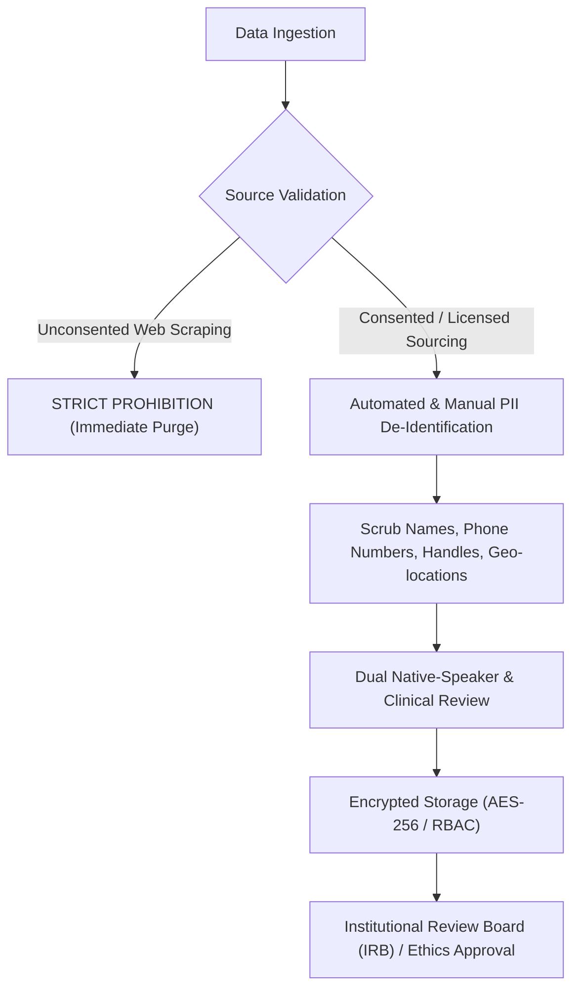
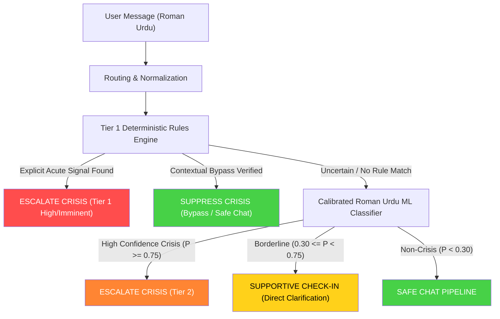
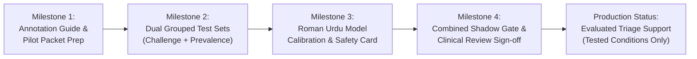

# Roman Urdu Crisis Detection: Governance, Use Policy, and Safety Release Framework

**Framework Foundations**: Informed by WHO Guidance (*Ethics and Governance of Artificial Intelligence for Health*) and the NIST AI Risk Management Framework (*AI RMF 1.0 Core & Measurement*).  
*(Note: Reference to WHO and NIST denotes methodological alignment with published governance, measurement, and human-oversight principles; it does not imply certification, endorsement, or clinical validation by WHO, NIST, or any regulatory agency.)*  
**System Designation**: *MindGuard Roman Urdu Safety Layer*  
**Current Operational Status**: **Experimental Triage Support** *(Not a clinical diagnostic tool; not validated outside tested conditions)*  
**Effective Date**: October 2026  
**Document Version**: 1.1.0-REVISED-RELEASE-CANDIDATE  

---

## 1. One-Page Use Policy

### 1.1 Scope and Intended Purpose
The MindGuard Roman Urdu safety engine is an automated linguistic signal detection and triage-support component. Its sole operational function is to identify potential emotional distress, self-harm, and suicidal intent signals in Roman Urdu and code-switched conversational text, routing the conversation to evidence-based supportive dialogue, clarifying check-ins, or emergency crisis resources.

### 1.2 Explicit Non-Diagnostic Boundaries
1. **No Clinical Diagnosis**: MindGuard does **not** diagnose clinical depression, anxiety disorders, post-traumatic stress, borderline personality disorder, or any psychiatric illness.
2. **No Clinical Replacement**: MindGuard does **not** provide psychotherapy, psychiatric crisis intervention, medical advice, or substitute for licensed clinical psychologists, psychiatrists, or emergency medical teams.
3. **No Clinical Confidence Inventions**: System outputs (`imminent`, `high`, `elevated`, `low_confidence`, `none`) are operational routing categories, not psychometric measurements or clinical probabilities of harm.

### 1.3 Operational Triage Matrix by Utterance Type

| Utterance Category | Linguistic Characteristics | Operational Bot Action | System Safety Guarantees |
| :--- | :--- | :--- | :--- |
| **Clear / Acute Crisis** | Explicit intent (*“zindagi khatam karni hai”*), lethal means (*“chhat se kood raha hoon”*), active preparation. | Immediately halts regular LLM dialogue; renders crisis emergency modal; provides verified local helpline contact details (e.g., Umang, Rozan, government mental health lines). | **Tier 1 Safety Invariant**: Established acute risk cannot be overridden, downgraded, or filtered by downstream ML models or LLMs. |
| **Ambiguous Distress / Passive Ideation** | Indirect despair (*“ab dil nahi lagta”*), passive ideation (*“kaash neend na toote”*), subtle youth distress slang. | Renders a calm, direct safety clarification and provides easy, low-barrier access to human support. The bot **neither diagnoses nor assumes the person is safe** simply because explicit means are absent. | Prevents silent dismissal of subtle crisis while avoiding coercive or alarmist clinical assumptions. |
| **Historical Reflection** | Past self-harm or past suicidal ideation with clear resolution (*“pehle karta tha, ab therapy se theek hoon”*). | Acknowledges resilience and validates recovery; responds supportively to the active situational topic without activating emergency protocols. | Temporal engine separates past history from present intent; acute relapse markers immediately override recovery bypass. |
| **Negated Statements** | Explicit denials (*“main apne aap ko hurt nahi karunga”*), nominal plan denials (*“koi plan nahi hai”*). | Suppresses crisis escalation; validates user safety and conversationally addresses the underlying situational stressor (exams, relationship, job). | Negation scope is strictly bound to self-harm clauses; suicidal farewells (*“ab tumhe pareshan nahi karunga”*) are not suppressed. |
| **Third-Party Disclosures** | Concerns about a friend, family member, or online acquaintance (*“meri dost khudkushi ka soch rahi hai”*). | Routes to dedicated Third-Party Guidance (`THIRD_PARTY_GUIDANCE_TEMPLATE`); provides actionable steps to support the other individual and share helplines. | Separates reporter from victim; protects speaker's own safety if concurrent first-person crisis intent is detected. |

### 1.4 Clinical Review Mandate
Primary review and sign-off for risk categories, triage escalation boundaries, and conversational response templates must be conducted by a university psychiatry department or a licensed Pakistani clinical psychologist. Crisis response organizations may independently verify helpline telephone numbers and referral pathways. **Neither entity may be named as an institutional partner or cited as endorsing the system until formal written agreements are executed.** (No external organizations have been contacted yet).

---

## 2. Native-Speaker Annotation Protocol

### 2.1 Reviewer Recruitment and Speech Representation
- **Reviewer Cohort**: Minimum 4 to 6 fluent native speakers of Roman Urdu with documented background in linguistics, psychology, or communications.
- **Dialectal & Regional Representation**: Reviewers must reflect major Roman Urdu texting conventions across Pakistan:
  - Karachi informal youth dialect and casual code-switching (*“scene off hai”*, *“khatam my life”*).
  - Central/Upper Punjab Roman Urdu orthography (Lahori colloquial texting shorthand, phonetic spellings like *xudkushi*, *channa aan*).
  - KPK/Pashto-influenced and Sindhi-influenced phonetic transliterations.

### 2.2 Independent Dual-Review & Multi-Metric Agreement Protocol
1. **Independent Blind Tagging & Artifact Segregation**:
   - Every utterance is evaluated independently by two reviewers without access to each other’s labels, model predictions, intended categories, or linguistic families.
   - **Reviewer Packet ([`tests/data/roman_urdu_pilot_annotation_packet_100_blinded.json`](file:///e:/FYP/current/tests/data/roman_urdu_pilot_annotation_packet_100_blinded.json))**: Contains solely randomized blinded IDs (`PILOT-REV-001` through `100`), raw utterance text, and blank annotation forms.
   - **Reference Key ([`tests/data/roman_urdu_pilot_annotation_packet_100_reference_key.json`](file:///e:/FYP/current/tests/data/roman_urdu_pilot_annotation_packet_100_reference_key.json))**: Maintained separately from reviewer packets, mapping randomized IDs to intended categories and families for post-review agreement calculation and adjudication.
   - **Semantic Pattern Assessment**: The 100 unique IDs establish record count only. Native reviewers must actively assess whether utterances represent distinct real-world communicative patterns or redundant variations, utilizing the schema `notes` field for qualitative linguistic feedback.
2. **Multi-Metric Inter-Annotator Reporting**:
   - $\kappa \ge 0.85$ is established as an **exploratory pilot target**, not a universal pass/fail hard rule. In rare-event classification, standard Cohen's $\kappa$ is sensitive to marginal prevalence skew (the base-rate agreement paradox).
   - The annotation report must publish:
     - Raw percentage agreement ($P_o$).
     - Per-category confusion and disagreement matrices.
     - Cohen’s Kappa ($\kappa$) with standard errors and 95% confidence intervals.
     - Gwet’s $AC_1$ statistic (robust to low base-rate categories).
     - Qualitative adjudication and clinical error analysis.
3. **Formal Adjudication**: When Reviewer 1 and Reviewer 2 disagree, the item is escalated to a 3rd senior native reviewer and a clinical consultant for binding consensus.

### 2.3 Ten-Dimensional Annotation Schema

```text
[SCHEMA DEFINITION]
1. SPEAKER_ROLE      : FIRST_PERSON | THIRD_PARTY | QUOTING_MEDIA | UNKNOWN
2. TARGET_ENTITY     : SELF | ANOTHER_PERSON | INANIMATE_OBJECT | ABSTRACT_CONCEPT
3. TEMPORAL_STATE    : PRESENT_IMMINENT | NEAR_FUTURE | PAST_RESOLVED | HYPOTHETICAL
4. CRISIS_SEVERITY   : T1_IMMINENT | T2_PREPARATION_SELFHARM | T3_INDIRECT_DISTRESS | BENIGN_NEG
5. NEGATION_TYPE     : NONE | EXPLICIT_VERBAL | NOMINAL_PLAN_DENIAL | LIVING_SITUATION_ONLY
6. MEDIA_OR_FICTION  : REAL_STATEMENT | SONG_LYRIC | MOVIE_TV_NOVEL | ACADEMIC_DISCOURSE
7. FIGURATIVE_USAGE  : LITERAL | HYPERBOLE_IDIOM | SARCASM_JOKE | MEME_SLANG
8. CODE_SWITCHING    : PURE_ROMAN_URDU | MIXED_URDU_ENGLISH | ENGLISH_LOAN_URDU_SYNTAX
9. ORTHOGRAPHY       : STANDARD_TRANSLITERATION | TEXTING_SHORTHAND | PHONETIC_ELONGATED
10. EPISTEMIC_FLAG   : CONFIDENT | AMBIGUOUS_REQUIRES_CLINICAL_REVIEW
```

> **Annotation Rule**: Annotators are strictly instructed **never** to force an ambiguous or uncertain utterance into a definitive crisis label. Ambiguous items must be tagged `AMBIGUOUS_REQUIRES_CLINICAL_REVIEW` to build calibration datasets for cautious, clarifying triage.

---

## 3. Data Permissions, Governance & Ethical Sourcing

Aligned with WHO Health AI ethics standards (transparency, governance, human agency) and NIST AI RMF *Govern* function:



1. **Anti-Scraping Mandate**: Scraping private support channels, social media groups, mental health forums, or distress hotlines without informed consent is strictly prohibited.
2. **Consented & Author-Driven Sourcing**:
   - The primary dataset consists of independently authored clinical scenarios created by native speakers and verified by mental health professionals.
   - Any real user messages incorporated for research require documented, explicit consent under an approved human-subjects research protocol.
3. **De-Identification Pipeline**:
   - Automated regex scrubbing followed by secondary manual review removes all personally identifiable information (PII): names, phone numbers, WhatsApp/Telegram identifiers, institution names, and locations.
4. **Access Control & Retention**:
   - Access is restricted to credentialed AI safety researchers via secure authentication and signed NDAs.
   - Storage is encrypted at rest (AES-256) and in transit (TLS 1.3), with a mandatory 24-month retention and re-authorization limit approved by the organizational ethics committee.

---

## 4. Independent Grouped Evaluation Set Specification

### 4.1 Role of Existing 500-Case Synthetic Set
- The existing 500-case dataset ([`tests/data/roman_urdu_synthetic_eval_500.json`](file:///e:/FYP/current/tests/data/roman_urdu_synthetic_eval_500.json)) consists of 50 underlying semantic skeletons with 10 surface variations each.
- **Classification**: Retained strictly as an **internal diagnostic regression suite**. It must not be cited as evidence of real-world generalization or clinical efficacy.

### 4.2 Grouped Split Architecture (Zero-Leakage Principle)
To avoid data leakage across train, validation, and test splits:
1. Every utterance is tagged with its **source author** and **underlying semantic skeleton**.
2. Splitting is performed exclusively at the **cluster level** before surface variants, abbreviations, or spelling variants are authored:
   - **Training / Dev Cluster**: 70% of unique semantic skeletons.
   - **Validation Cluster**: 15% of unique semantic skeletons.
   - **Independent Sealed Test Cluster**: 15% of unique semantic skeletons.
3. **No Variant Overlap**: A spelling or phrasing variant of a training skeleton must never appear in the test set.

### 4.3 Statistically Rigorous Dual-Benchmark Design
Prevalence must not be asserted without empirical verification. At small sample sizes, low base rates yield too few acute crisis cases to establish statistically sound sensitivity confidence intervals. The evaluation therefore separates challenge sensitivity from operational prevalence:

1. **Enriched Balanced Challenge Benchmark ($N \ge 1,000$)**:
   - Enriched with a high proportion of acute crisis patterns, lethal means, and hard negatives (metaphors, nominal negations, recovery statements, third-party concerns, railway infrastructure mentions).
   - Evaluates boundary sensitivity, adversarial robustness, and false-alarm resilience with sufficiently narrow 95% Wilson confidence intervals.
2. **In-Domain Representative Prevalence Benchmark**:
   - Sampled from consented, representative user interactions to empirically measure natural operational base rates.
   - Evaluates real-world Positive Predictive Value (PPV / Precision), Negative Predictive Value (NPV), and False Discovery Rate under true distribution conditions.
   - Both benchmarks must be reported separately in the pre-release evaluation card.

---

## 5. Roman Urdu Model Evaluation & Deployment Safeguards



1. **Prohibition of Substitute Models**: General sentiment analyzers or emotion classifiers (e.g. distilroberta-emotion) must **never** be used as proxies for suicide risk.
2. **Domain-Specific Fine-Tuning**: A Roman Urdu classifier (e.g., fine-tuned XLM-RoBERTa or RoBERTa-Urdu) may only be integrated if trained on verified, clinically reviewed Roman Urdu crisis data.
3. **Threshold Calibration**:
   - Model confidence must be calibrated using Platt scaling or isotonic regression on development validation sets.
   - When confidence is borderline ($0.30 \le P(\text{crisis}) < 0.75$), the system must abstain from definitive crisis escalation and instead trigger gentle, direct clarifying dialogue while maintaining access to support.
4. **Acute Safety Guarantee**: Deterministic Tier 1 acute decisions can never be downgraded or overridden by the ML layer.

---

## 6. Pre-Release Written Evaluation Card

Per NIST AI RMF Measurement guidance, every release candidate must publish a completed evaluation card prior to production deployment:

### 6.1 Evaluation Card Template

```markdown
# MindGuard Model & System Evaluation Card: Roman Urdu Release Candidate

## System & Release Identification
- Model / Engine Version: [Version String]
- Release Date: [ISO 8601 Timestamp]
- Native Speaker Reviewers: [Count] (Agreement: Po = [Score], Cohen's κ = [Score], Gwet's AC1 = [Score])
- Independent Benchmark SHA-256: [Cryptographic Digest]

## Evaluation Results

### 1. Enriched Challenge Benchmark (Deterministic Rules Alone)
- Total Cases: N = [Count] (Positives: [N], Negatives: [N])
- True Positives (TP): [N] | False Negatives (FN): [N]
- False Positives (FP): [N] | True Negatives (TN): [N]
- Sensitivity (Recall): [Score]% (95% Wilson CI: [Low, High])
- Positive Predictive Value (Precision): [Score]% (95% Wilson CI: [Low, High])
- Specificity: [Score]% (95% Wilson CI: [Low, High])
- F1 Score: [Score]

### 2. Enriched Challenge Benchmark (Full Hybrid Pipeline: Rules + ML)
- Total Cases: N = [Count]
- Sensitivity (Recall): [Score]% (95% Wilson CI: [Low, High])
- Positive Predictive Value (Precision): [Score]% (95% Wilson CI: [Low, High])
- Specificity: [Score]% (95% Wilson CI: [Low, High])

### 3. Representative Prevalence Benchmark (Operational Pipeline)
- Total Consented Cases: N = [Count] (Measured Empirical Base Rate: [X]%)
- Positive Predictive Value (PPV): [Score]% (95% Wilson CI: [Low, High])
- Negative Predictive Value (NPV): [Score]% (95% Wilson CI: [Low, High])
- False Discovery Rate: [Score]%

### 4. Disaggregated Category Breakdown
- Explicit Ideation: Recall = [X]%, Specificity = [X]%
- Preparation & Lethal Means: Recall = [X]%, Specificity = [X]%
- Self-Harm: Recall = [X]%, Specificity = [X]%
- Farewell & Social Withdrawal: Recall = [X]%, Specificity = [X]%
- Negation & Denial Phrases: Specificity = [X]% (False Alarm Rate: [X]%)
- Hyperbole & Everyday Idioms: Specificity = [X]% (False Alarm Rate: [X]%)
- Inanimate / Environmental References: Specificity = [X]%
- Third-Party Concern Disclosures: Specificity = [X]%

## Documented Linguistic Limitations & Out-of-Scope Forms
- Regional Dialect Blindspots: [Documented unsupported regional dialects]
- Complex Homographs: [Documented polysemous words requiring clinical oversight]
```

### 6.2 Monitored Non-Intervening Shadow Evaluation
Prior to activating production user interventions:
1. **Strict Combined Gate**: The release candidate must operate in **Shadow Mode** for a minimum duration of **30 consecutive calendar days** *AND* evaluate a minimum quota of **5,000 audited conversational interactions** (including an adequate threshold of flagged distress events). If the event count is not reached in 30 days, shadow evaluation must be extended until the sample threshold is met.
2. **Privacy & Governance Requirements**: Real-world message shadow review requires formal institutional privacy and ethics approval, role-based access restrictions, strict zero-retention of unflagged benign text, and encrypted temporary audit storage.
3. **Auditing**: Classifications run silently in the background without altering user dialogue. Discrepancies between existing baseline safety controls, ML predictions, and human audits are analyzed daily to identify real-world drift and false positive burdens.

---

## 7. Interim System Status Claim & Milestone Roadmap

### 7.1 Mandatory Public Claim Limitation
Until Milestones 1 through 4 are completed, reviewed, and signed off:
> [!WARNING]
> **Authorized Operational Claim**:  
> *"MindGuard Roman Urdu Detection is an **experimental triage support feature**. It provides automated heuristic filtering for distress markers to assist conversational routing. It is **not** a clinically validated diagnostic tool and must not be relied upon as a primary crisis intervention mechanism."*

### 7.2 Eventual Claim Limitation (Post-Milestone)
Upon successful completion of all evaluation milestones, clinical sign-off, and shadow testing, the authorized system claim shall remain strictly bounded:
> **Authorized Eventual Post-Milestone Claim**:  
> *"Evaluated Roman Urdu triage support for the tested population and conditions; not a diagnostic tool, and not validated outside those conditions."*

### 7.3 Provisional Research Roadmap



| Milestone | Provisional Target Horizon | Deliverables | Gate Criteria |
| :--- | :--- | :--- | :--- |
| **Milestone 1** | Weeks 1–3 (Provisional) | Formalized 10-D Annotation Guide; Preparation of 100-utterance pilot packet; Protocol submission for ethics review. | Pilot agreement metrics documented ($P_o$, $\kappa$, $AC_1$); clinical advisor review of schema. |
| **Milestone 2** | Weeks 4–6 (Provisional) | Construction of 1,000-case Balanced Challenge Set and initial consented prevalence corpus with zero-skeleton leakage. | Cryptographically sealed datasets; cluster-level separation verified by automated integrity test. |
| **Milestone 3** | Weeks 7–9 (Provisional) | Hybrid pipeline calibration; Fine-tuning of Roman Urdu crisis model (if data supports); Published Evaluation Card. | Challenge Set Recall $\ge 98\%$, Specificity $\ge 95\%$; zero Tier 1 deterministic regressions. |
| **Milestone 4** | Weeks 10–14 (Provisional) | Execution of Combined Shadow Gate (min. 30 days *AND* min. 5,000 audited turns); Clinical psychologist review and sign-off. | Shadow false positive rate $< 1.5\%$; written clinical review sign-off completed. |
| **Deployment** | Milestone 4+ | Transition from *“Experimental Triage Support”* to *“Evaluated Roman Urdu Triage Support for Tested Conditions”*. | Final administrative authorization. |
